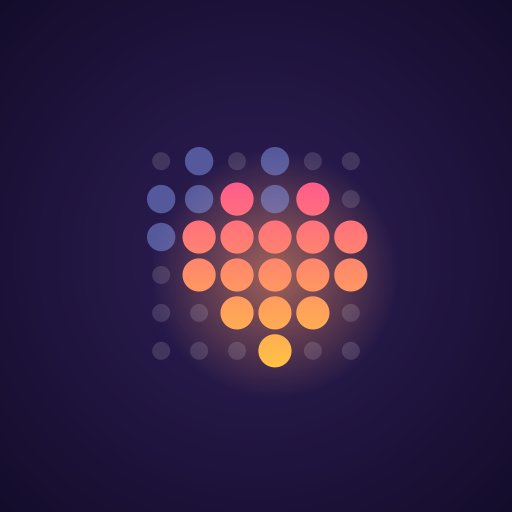

# Fairy Lights

Control **Hello Fairy** Bluetooth LED lights without the vendor app, and make your own pixel animations for them.



Hello Fairy lights are normally run from the vendor's phone app (Android package **`com.hsr.hellofairy1`**, by Hysiry
Technology). This project talks to the lights directly over Bluetooth Low Energy. It isn't affiliated with the vendor.

## What's in it

- **Animation builder** (runs in your browser): paint pixels frame by frame with a ghost of the previous frame,
  copy a frame and edit the copy, move selections around, swap one colour for another across the whole animation,
  turn text into scrolling frames, and send it to the lights.
- **Android app** (`android/`): the same builder on your phone.
- **Command line** (`fairy.py`): power, colour, scenes, text, and playing a saved animation.

## Try it on a PC

Needs Python 3 and a Bluetooth adapter. Tested on Linux (BlueZ).

```sh
./start.sh                # sets up a Python environment on first run, then opens http://localhost:8780
```

Close the vendor app first. The lights accept one Bluetooth connection at a time.

```sh
.venv/bin/python fairy.py on
.venv/bin/python fairy.py color ff8800 -b 60
.venv/bin/python fairy.py text "HELLO" --mode left --hue 60
.venv/bin/python fairy.py play projects/my-animation.json
```

## The phone app

Needs the Android SDK and JDK 17.

```sh
cd android && ./gradlew :builder:assembleDebug     # APK: android/builder/build/outputs/apk/debug/
```

## The picture library (optional, not included)

The vendor app ships with about a thousand ready-made pictures and animations. They're the vendor's artwork, so they
aren't in this repository, but the builder can import them from your own copy of the app so you can browse them in
its Library panel:

1. Get the APK of **`com.hsr.hellofairy1`** from your own phone (it's a split APK; you need `base.apk`):
   ```sh
   adb shell pm path com.hsr.hellofairy1        # prints the path of base.apk and the split files
   adb pull <path to base.apk> .
   ```
2. Import it:
   ```sh
   .venv/bin/pip install pillow
   .venv/bin/python tools/import_library.py base.apk   # writes library/ (about 1,000 items)
   ```
3. Reload the builder. To get the library into the phone app, rebuild it (the build bundles `library/`).

Please don't redistribute the APK or the imported library.

## Your lights

Built and tested against one string: model `BSL84`, 800 LEDs laid out as 40 columns by 20 rows. The grid size is set at
the top of `fairy.py`; other models may need a different size. The lights only take one-byte hue colours, so full
RGB isn't possible. Details are in [PROTOCOL.md](PROTOCOL.md).

## License

[MIT](LICENSE). The licence covers the code in this repository, not the vendor's app or artwork.
